<div align="center">

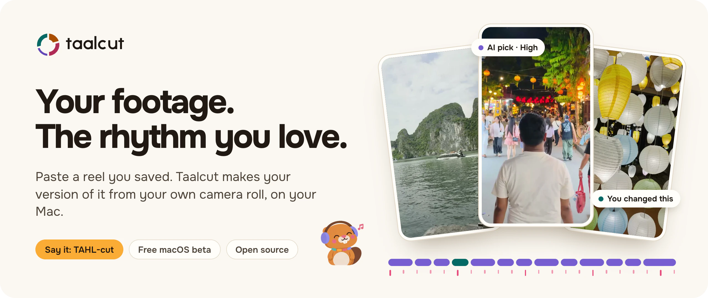

# Taalcut

**Make the reel you saved, with your own clips.**

Say it _TAHL-cut_, the _aa_ as in “father”. Taal is the rhythm cycle in Indian music. Taalcut cuts your clips to the rhythm of a reel you love.

<p>
  <a href="#get-it"></a>
  <a href="https://github.com/satyajiit/taalcut/releases/tag/v0.1.0"></a>
  <a href="#get-it"></a>
  <a href="LICENSE"></a>
</p>
<p>
  <a href="#why-i-made-it"></a>
  <a href="#how-it-works"></a>
  <a href="#known-limits"></a>
  <a href="#the-name-the-logo-and-the-beaver"></a>
</p>
<p>
  <a href="#your-ai-your-call"></a>
  <a href="#your-ai-your-call"></a>
  <a href="#contributing"></a>
  <a href="#contributing"></a>
  <a href="https://taalcut.app"></a>
  <a href="https://matterwardlabs.com"></a>
</p>

[How it works](#how-it-works) · [A look around](#a-look-around) · [Your AI](#your-ai-your-call) · [Why I made it](#why-i-made-it) · [The name](#the-name-the-logo-and-the-beaver) · [Get it](#get-it) · [Build from source](#build-from-source)

From [Matterward Labs](https://matterwardlabs.com).

</div>

Taalcut is a video editor for creators that makes your version of a reel you love, from your own camera roll. You paste the reel. It reads the cuts and the music beats, picks a clip of yours for each part, and hands you a cut on a timeline that you can keep changing.

It is a free Mac app and it runs on your computer. Your clips are indexed and searched there. The AI is either a model the app runs on your Mac or an account you already have.

## How it works

<p align="center">
  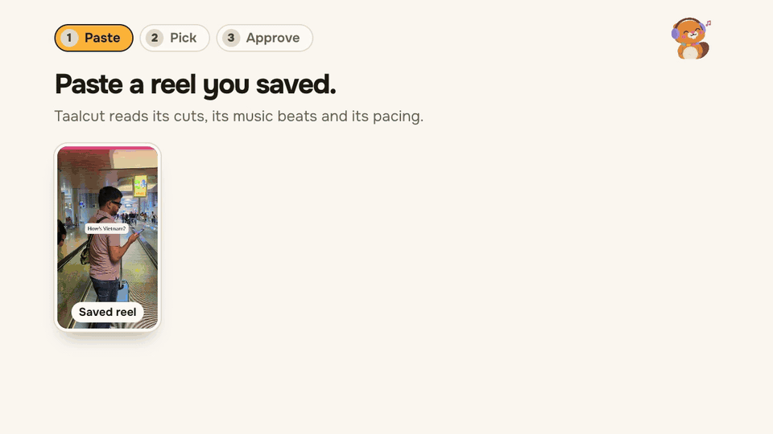
</p>

| Step           | What happens                                                                                                                                                                |
| -------------- | --------------------------------------------------------------------------------------------------------------------------------------------------------------------------- |
| **1. Paste**   | Paste a reel’s link or drop its video in. Taalcut reads its cuts, music beats, on-screen text, transitions and pacing, and you can fix a cut before it’s used.              |
| **2. Pick**    | Each slot says what it wants. The AI picks a clip from your camera roll, shows how sure it is (High, Medium or Low) and keeps up to three other shots in case you disagree. |
| **3. Approve** | The agent checks the cut against the reel. You watch your version and approve once. Undo covers every edit, the agent’s included.                                           |

The reel you pasted stays as a template. Fill it with this weekend’s trip, then next month’s.

## A look around

<p align="center">
  <a href=".github/media/screen-editor.webp">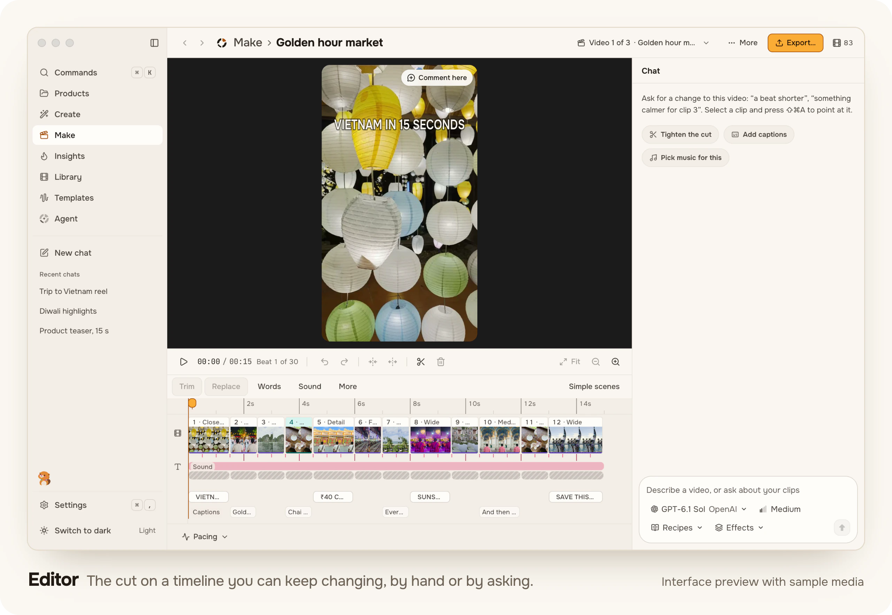</a>
</p>

<table>
  <tr>
    <td width="50%" align="center">
      <a href=".github/media/screen-agent.webp">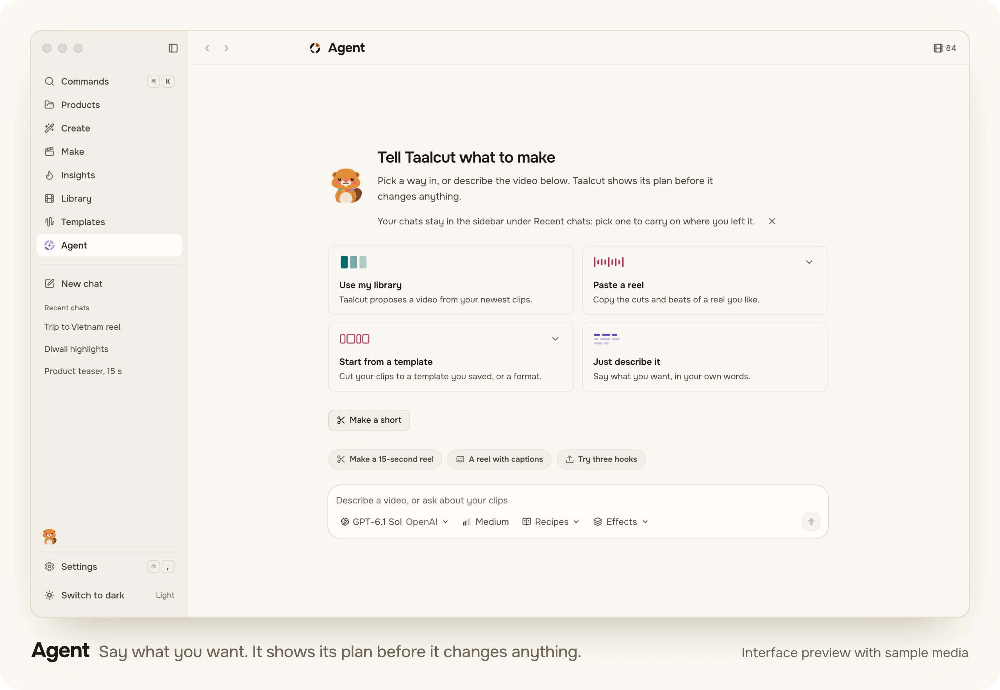</a><br>
      <strong>Agent</strong><br><sub>Say what you want in a sentence. It shows its plan before it changes anything.</sub>
    </td>
    <td width="50%" align="center">
      <a href=".github/media/screen-library.webp">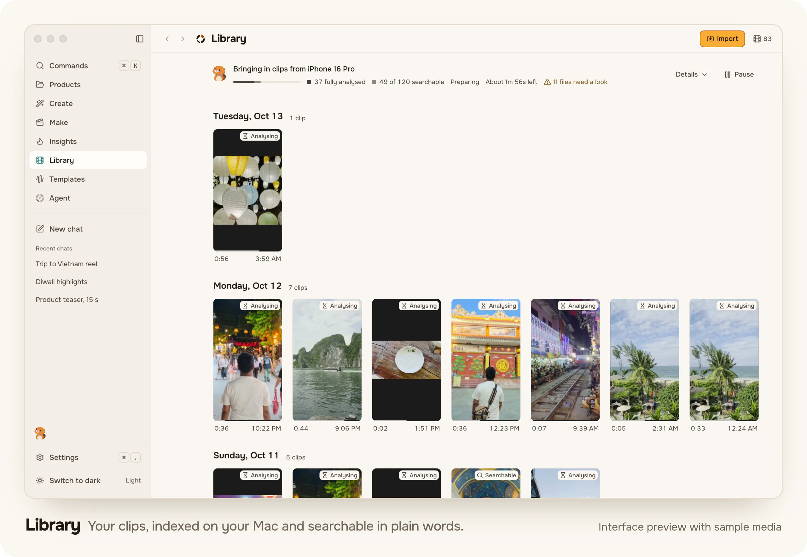</a><br>
      <strong>Library</strong><br><sub>Your clips, indexed on your Mac. Search by describing a shot, or something said in it.</sub>
    </td>
  </tr>
  <tr>
    <td width="50%" align="center">
      <a href=".github/media/screen-template.webp">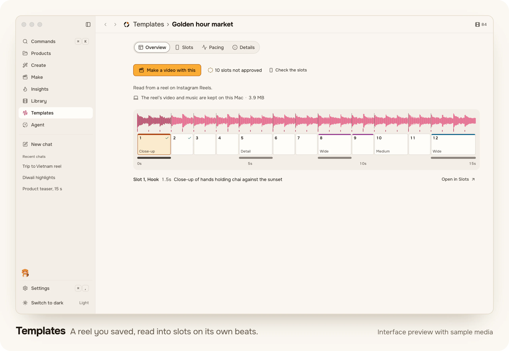</a><br>
      <strong>Templates</strong><br><sub>A reel, read into slots on its own beats. Yours to keep and fill again.</sub>
    </td>
    <td width="50%" align="center">
      <a href=".github/media/screen-make.webp">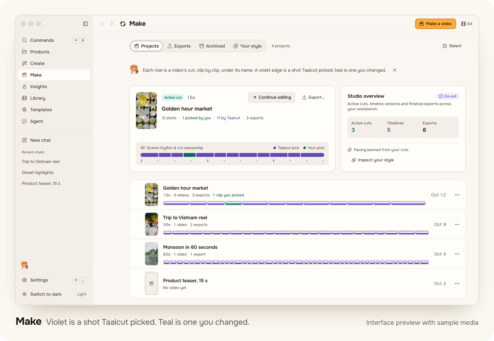</a><br>
      <strong>Make</strong><br><sub>Every AI decision shows. Violet is a shot Taalcut picked, teal is one you changed.</sub>
    </td>
  </tr>
</table>

<sub>Interface previews with sample media: the app’s own sample projects, with stills from the demonstration footage in this repository ([media terms](MEDIA-LICENSE.md)). Click a picture for the full size.</sub>

More of what’s inside:

- **Clips from your phone without an app.** Scan a QR code, enter the PIN, and clips come over your Wi-Fi. Folders on your Mac are read in place.
- **Export where it’s going.** MP4 in H.264 or HEVC, sized for Reels, Shorts and TikTok, with captions as an SRT file if you want them.
- **More corners to try.** The same app has Create (a video from a brief), Products and Insights. The release checks covered the reel path above; the rest has had less testing.

## Your AI, your call

<p align="center">
  <a href=".github/media/screen-consent.webp">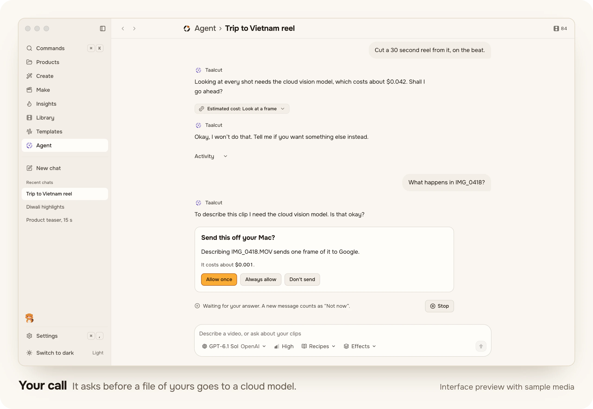</a><br>
  <sub>Interface preview with sample media.</sub>
</p>

- **Private by default.** Indexing, search, text in video and music beats run on your Mac, and your footage stays there. No upload, no storage cap.
- **No AI subscription needed.** Taalcut downloads the models and runtimes it needs and runs them itself. There is nothing else for you to install.
- **Or use the AI you already pay for.** Continue with ChatGPT, add an API key (OpenAI, Anthropic, Google, OpenRouter), or point it at Ollama or LM Studio. Provider charges are yours and separate, and the app sells no credits.
- **Or have us set it up and run the models.** [Taalcut Premium](https://taalcut.app/premium/) is a paid plan around the free app: we install it with you, the top cloud models are paid by us, and support is on WhatsApp.
- **It asks first.** Before a cloud model first sees one of your files, Taalcut asks. Settings › Privacy lists what leaves your Mac.
- **Local only.** One switch in Settings › Privacy: no cloud models, uploads, reel links, feedback or usage counts. Update checks still send the app’s version and a random ID.

## Why I made it

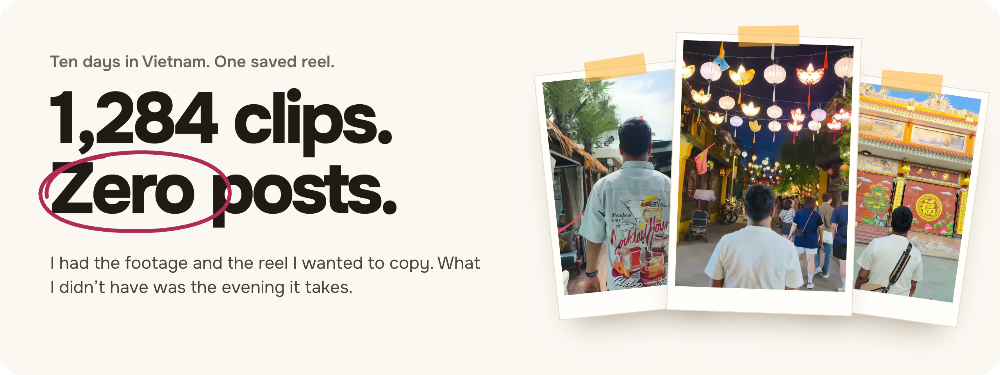

I’m Satyajit, and I make Taalcut. Ten days in Vietnam left me with a camera roll full of clips and one saved reel I wanted to make my own version of.

Copying a reel’s cuts and timing by hand takes an evening. The shot you need is in the camera roll somewhere, and scrolling for it takes longer than the reel lasts. I didn’t have the evening, so the reel stayed saved, the clips stayed where they were, and the trip produced zero posts.

I built Taalcut for that gap between having footage and actually making something with it. It reads the reel, so I don’t count cuts, and it looks through the camera roll, so I don’t scroll. What comes out is a first cut I can argue with, with the AI’s choices marked as its own.

Building an editor to save one evening has cost me a good many more than one. I stand by the trade.

<p align="center">
  <a href="https://www.youtube.com/watch?v=w3PZrIf9CGY">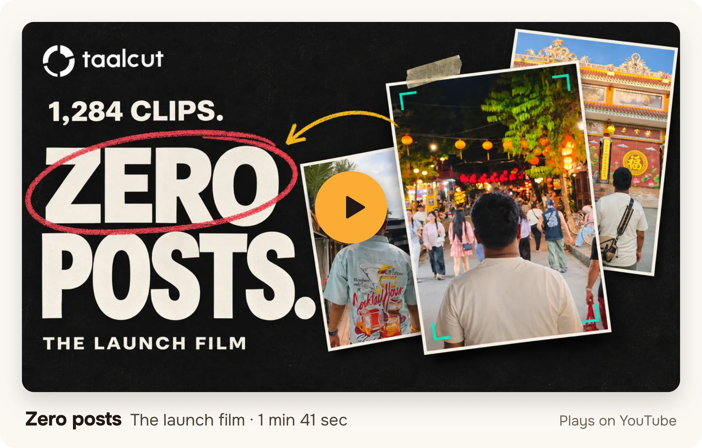</a><br>
  <a href="https://www.youtube.com/watch?v=w3PZrIf9CGY"><strong>Watch “Zero posts” on YouTube ↗</strong></a> · 1 min 41 sec<br>
  <sub>It was made before the release, so its closing card still talks about a waitlist. The download is below.</sub>
</p>

## The name, the logo and the beaver

Two words, one rhythm. Taal keeps time, and cut is what an editor does.

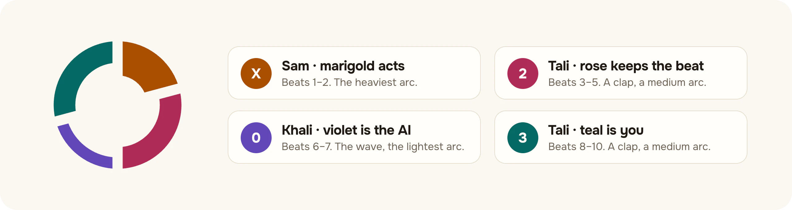

The logo is one _avartan_, a single turn of a rhythm cycle. It is drawn as jhaptaal: ten beats in groups of two, three, two and three. Sam, the first beat, is the heaviest arc. The two claps are medium and the wave is the lightest. The gaps between the arcs are the cuts. The arcs carry the app’s four colours in the order of their jobs: marigold acts, rose keeps the beat, violet is the AI and teal is you. The [logo kit](design/logo/kit/README.md) has the files and the rules.

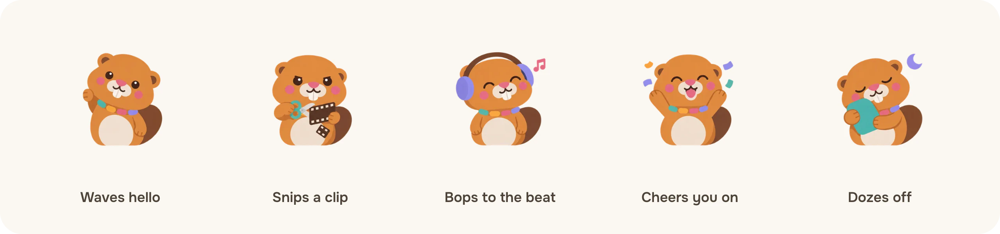

Kaatu is Taalcut’s mascot, a young beaver. The name comes from काटना, “to cut”: beavers cut, and Taalcut cuts your clips to the beat. In the app Kaatu keeps you company at the foot of the sidebar. It thinks while work runs, looks pleased when it ends well and falls asleep after a quiet minute. It never sits on your footage. [More about Kaatu](design/mascot/README.md).

## Get it

You need a Mac with Apple silicon (M1 or later) on macOS 14 or later. 8 GB of memory and 20 GB of free space are recommended.

1. Download `Taalcut-0.1.0-arm64.dmg` from the [0.1.0 release](https://github.com/satyajiit/taalcut/releases/tag/v0.1.0).
2. Open it and drag Taalcut into Applications.
3. Open Taalcut. It checks your Mac, picks models that fit it and downloads them in the background while you add a folder or connect a phone.

The app is signed with a Developer ID and notarized by Apple, so it opens the ordinary way. The release also lists SHA-256 sums for the files, and its [notes](release-notes/0.1.0/en.md) say what’s in it. Releases are built, signed and published by hand.

Stuck? Start with the [FAQ](docs/support/faq.md) and [troubleshooting](docs/support/troubleshooting.md). A [debug bundle](docs/support/debug-bundle.md) is the quickest way to show what went wrong.

### Known limits

This is the first release, and it has rough edges. Keep your original media, and watch an export before you post it.

- **The on-device AI doesn’t always finish.** On a 24 GB Mac, the default on-device model (a small one, 4 billion parameters) picked clips for a whole template in 5 of 8 test makes, and none of the makes ran from start to finish unattended. When a make stops, the chat says where and offers **Try again** and **Open editor**, and whatever was assembled is kept, so you finish in the editor. Larger on-device models and cloud models weren’t part of that test.
- **A make takes a while.** Those test makes ran from 6 to 17 minutes each.
- **8 GB Macs need help with pictures.** On a Mac with 8 GB of memory, understanding images needs a cloud account.
- **Apple silicon Macs only.** There is no Windows or Linux installer.
- **English only.** Hindi, Spanish and Brazilian Portuguese are draft translations, and help reviewing them is welcome.
- **Free means free.** The app is free and there is nothing to buy inside it. [Premium](https://taalcut.app/premium/) is a separate paid service, ordered on the website.

## Build from source

You need Node.js `>=24.11` and pnpm `11.22.0`, on an Apple silicon Mac. Developing on Ubuntu works too and needs two more steps, which are in [CONTRIBUTING.md](CONTRIBUTING.md#on-linux).

```sh
git clone https://github.com/satyajiit/taalcut.git
cd taalcut
pnpm install --frozen-lockfile
pnpm --filter @taalcut/renderer build
pnpm dev
```

`pnpm dev` builds the Electron main, preload and utility processes and opens the app. Quit the app to stop it. If another Taalcut is already running, this one exits at once, because the app keeps a single instance. The renderer build comes first because the desktop build serves a placeholder page without it.

Media jobs need the LGPL FFmpeg sidecar, which is not in the clone. [tools/ffmpeg/README.md](tools/ffmpeg/README.md) says how to build it. The shell starts without it. `pnpm check` runs the typecheck, the linters, the tests and the string-catalogue check.

<details>
<summary><strong>What’s in the repository</strong></summary>

It is an Electron and TypeScript monorepo. Packages are consumed as TypeScript source, with no build step between them.

| Path                                | What it is                                                                                       |
| ----------------------------------- | ------------------------------------------------------------------------------------------------ |
| `apps/desktop`                      | Electron main, preload and utility processes. Everything is wired together here.                 |
| `apps/renderer`                     | The sandboxed React interface.                                                                   |
| `packages/agent`                    | The agent loop, its skills, memory and budgets.                                                  |
| `packages/models`                   | Providers, sign-in and model profiles. The only package that talks to a model.                   |
| `packages/library`                  | The database, its migrations and the search index.                                               |
| `packages/templates`                | Reading a reel into a template.                                                                  |
| `packages/timeline`                 | The timeline model, clip-picking and beat sync.                                                  |
| `packages/vision`, `packages/audio` | Shots, text in video and frame descriptions. Beats, speech and loudness.                         |
| `packages/media`, `packages/render` | The FFmpeg wrapper. HyperFrames compositions, from timeline to frames to a file.                 |
| `packages/jobs`                     | Durable jobs and the downloader for models and components.                                       |
| `tools/`, `native/`                 | The FFmpeg build, component manifests and evals. The Mac helper and the other native binaries.   |
| `website/`                          | The source of [taalcut.app](https://taalcut.app).                                                |
| `design/`                           | The logo kit, Kaatu, the tokens, and the scripts that made this page’s images (`design/readme`). |

On-device language models run through a llama.cpp server that the app installs and runs itself. The video components the AI designs are HyperFrames compositions. [SOUL.md](SOUL.md) is the agent’s character, written down: an editor called Taal with opinions about craft.

</details>

## Contributing

[Bug reports](https://github.com/satyajiit/taalcut/issues/new/choose), fixes and translation reviews are welcome. [CONTRIBUTING.md](CONTRIBUTING.md) has the setup, the checks to run before a pull request and the rules on strings and licence headers. The [code of conduct](CODE_OF_CONDUCT.md) applies here. Report a vulnerability privately, as [SECURITY.md](SECURITY.md) describes. The [changelog](CHANGELOG.md) keeps the history.

## License

Taalcut’s original code is licensed under the GNU Affero General Public License v3.0 or later. See [LICENSE](LICENSE) and the narrow [library combination permission](LICENSE-EXCEPTIONS.md). Third-party code keeps its own licences and notices, which are listed in [NOTICE](NOTICE). Taalcut does not own or relicense it.

The demonstration footage, and the stills from it on this page, have separate [media terms](MEDIA-LICENSE.md). The name and the logo follow the [trademark policy](TRADEMARKS.md), so a fork takes a name of its own.

Made by [Matterward Labs Private Limited](https://matterwardlabs.com). Write to [admin@matterwardlabs.com](mailto:admin@matterwardlabs.com).
