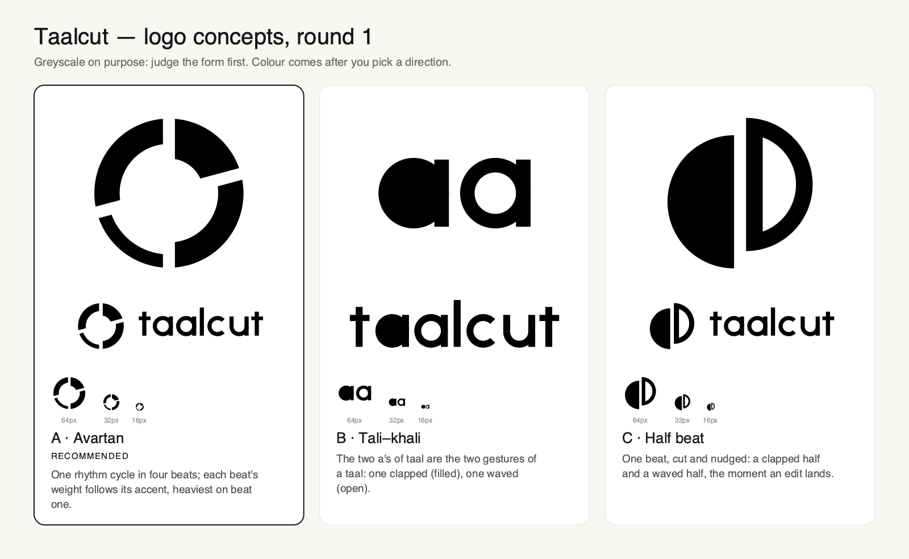

# Taalcut logo: round 1

As of 2026-10-12 · Companion to the naming research and the design system · Status: **decided, A (Avartan)**. The final files are in the [logo kit](kit/README.md)

## Brief

| | |
| --- | --- |
| **Name** | Taalcut, written `taalcut` in the wordmark. Said "TAHL-cut" |
| **What it does** | An open-source desktop studio that cuts your own phone footage to the beat and structure of a reel you love |
| **Audience** | Solo creators worldwide, mostly non-technical; open-source builders second |
| **Adjectives** | Rhythmic · warm · confident · crafted · open |
| **Story** | *Taal* is the rhythm cycle in Indian music. One line, never a theme |
| **Must work** | macOS dock and app icon, 16 px favicon, website header, GitHub avatar, one colour, reversed on dark |
| **Avoid** | CapCut's look (black-and-white, scissors, C-shapes), play triangles, film strips, waveform bars, music notes, multicolour segmented rings and grids |
| **Palette later** | Marigold, rose, teal and violet on warm neutrals (the design system) |

**Assumptions** (fast track, no discovery questions): the decision-maker is the product owner; the symbol must stand alone as an app icon; the wordmark is constructed, not typeset, so no font licence is involved.

## Category check

From the skill's 1,400-logo library (media, creative and music tools) and the PRD's competitor list: red play buttons (YouTube), waveform bars (SoundCloud), sound arcs (Spotify), glitch music notes (TikTok), multicolour pinwheels and segmented rings (Google Photos, Chrome), coloured grids (Microsoft). Creator video apps lean on scissors, play triangles and gradients. All of these were ruled out unless given a fresh form.

## Longlist

Ten one-sentence ideas, scored 1–5 on idea clarity, distinction, simplicity, relevance and 16 px strength (total out of 25).

| Idea | Type | Score | Result |
| --- | --- | --- | --- |
| **Avartan:** a rhythm cycle in four beats, each beat's weight following its accent | Abstract | 22 | **Built (A)** |
| **Tali–khali:** the two a's of taal as the clap (filled) and the wave (open) | Wordmark | 21 | **Built (B)** |
| **Half beat:** one beat cut and nudged, a clapped half and a waved half | Abstract | 20 | **Built (C)** |
| Four-beat bars (refining the DESIGN.md placeholder) | Abstract | 13 | Dropped: reads as an audio equaliser |
| Theka grid: teental's 16 beats as a 4×4 grid, the khali row empty | Abstract | 15 | Dropped: too close to Microsoft and Metabase grids; 16 parts is busy |
| Reel slots: a 9:16 frame cut into unequal slots | Abstract | 14 | Dropped: reads as a battery; with offsets it becomes TikTok-style glitch |
| Sam bead: a ring with one solid bead in a gap | Abstract | 13 | Dropped: reads as an orbit or a loader; close to CircleCI |
| Jump-cut lowercase t | Lettermark | 12 | Dropped: a lowercase t in a rounded square is Tumblr's territory |
| Latin wordmark hung from a Devanagari-style headline | Wordmark | 10 | Dropped: an exotic cliché, wrong for a global brand |
| Clap: two clips meeting like palms | Pictorial | 11 | Dropped: reads as a tent or a Λ |

## The three concepts

### A · Avartan (recommended)
A single rhythm cycle (*avartan*) drawn as four arcs in a 2:3:2:3 rhythm, after jhaptaal's 2+3+2+3 beats. Each arc's weight follows its accent: beat one (*sam*) is heaviest, the claps are medium, the empty beat (*khali*) is lightest. The cycle starts at the top, like a clock. It is the only concept that carries both halves of the name, taal (the cycle) and cut (the gaps), and it gives the identity a motion idea for free: the arcs can pulse with the beat in onboarding and on render progress. In colour, each arc can take one of the four accents for brand moments.

- **Construction:** outer radius 112 on a 256 grid; arc weights 60, 38, 20 and 38; parallel-sided cuts 18 units wide; arcs of 75° and 105° so every cut sits on a clean 15° angle.
- **Risk:** segmented rings are a familiar form. The uneven weights carry its distinctiveness, so they must survive refinement.

### B · Tali–khali
A custom geometric wordmark in which the two a's of *taal* are the two hand gestures of a rhythm cycle: the first a clapped (a solid bowl), the second waved (an open bowl). It teaches the spelling and the double "aa", which matters for a name people will hear before they read it.

- **Construction:** x-height 120, stems 26, horizontals thinned to 23, round letters overshoot by 3.
- **Risk:** the "aa" pair is wide and short, so at 16 px it becomes two dots. It would need a small-size cut, such as the filled a alone, for the favicon and dock icon.

### C · Half beat
A beat cut down the middle, its halves nudged a step apart like a jump cut: a solid half (the clap) and an open half (the wave). It is the boldest of the three at 16 px.

- **Construction:** radius 100; cut gap 18; halves slid 26 units apart; open half drawn with a 25-unit stroke.
- **Risks:** the open half reads as a capital D. The tali–khali link needs explaining. A diagonal cut was tried first and dropped because it read as ∅.

## Tests run

| Test | A | B | C |
| --- | --- | --- | --- |
| `svg_audit.py` (live text, rasters, angles, details) | 100/100 after angles were snapped | 100/100 | 100/100 |
| 16 / 32 px pixel test | Ring and uneven weight survive | Turns into two dots at 16 px | Clear |
| One colour, reversed, squint | Pass | Pass | Pass |
| Mirror and 180° rotation | Pass | Reads as "bp" (harmless) | Pass |
| Shelf test against 8 media logos | Distinct | Distinct (shares a rounded a with Last.fm, but the filled/open contrast is its own) | Distinct |

Files: [`concepts/`](concepts/) holds every iteration (v1–v4 plus the `x-` explorations). [`renders/preview-v4.html`](renders/preview-v4.html) is the full test sheet. [`build_concepts.py`](build_concepts.py) rebuilds everything with exact geometry.

Rejected along the way: a 30° cut for C (read as ∅ or a "no" sign), a horizontal cut for C (read as a smiling face), and a symmetric ring for A (read as a lifebuoy, then a crosshair).

## Not checked

- No trademark or reverse-image search; a professional search is needed before adoption.

## Decision and kit

A (Avartan) was chosen on 2026-10-12, after a [colour study](colour-study-a.png) on the DESIGN.md palette. The [logo kit](kit/README.md) has the refined geometry, seven colourways, lockups, the small-size drawing, app and web icons, a presentation board and the usage guide. It is generated by [`build_kit.py`](build_kit.py) and [`export_kit.py`](export_kit.py).
