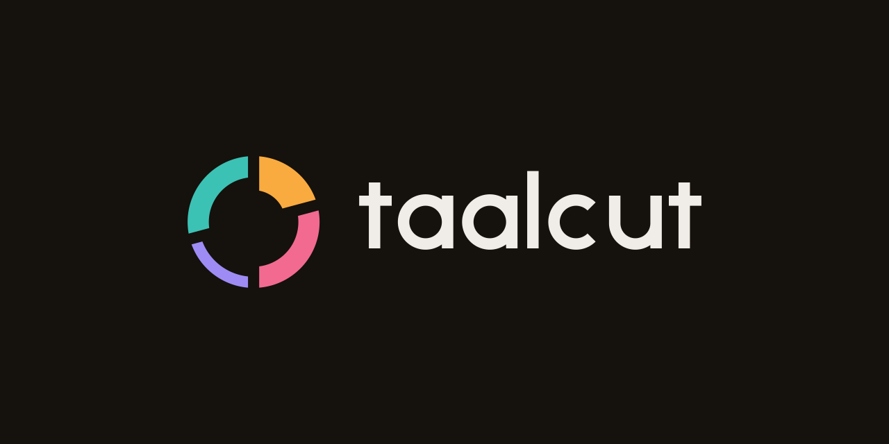
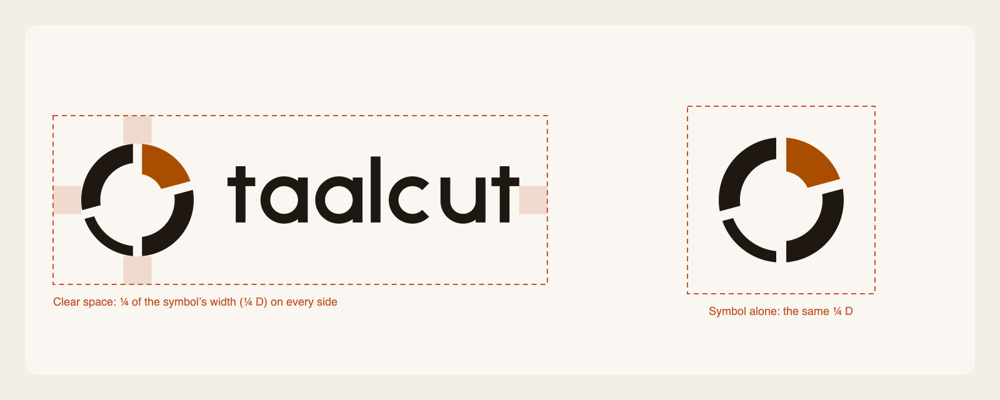
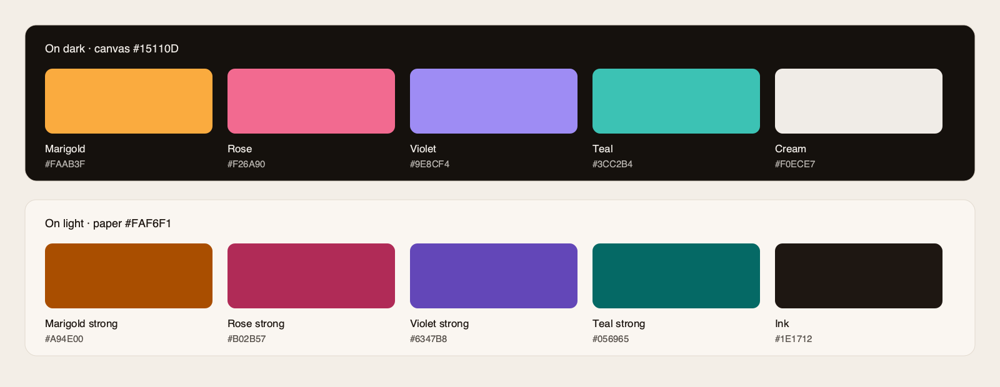
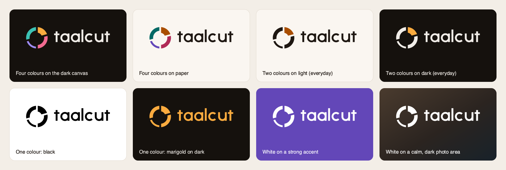
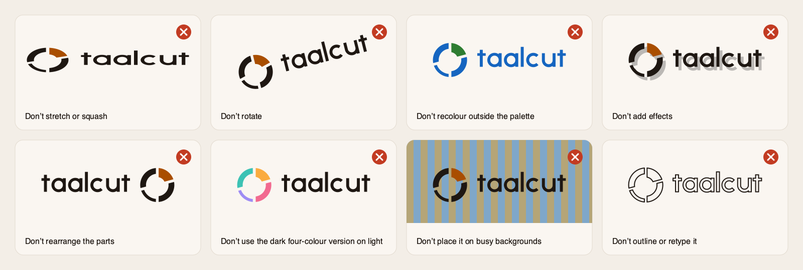

# Taalcut logo kit

As of 2026-10-12 · v1.0 · Direction A, "Avartan", chosen in [round 1](../README.md) · Palette from the design system



## 1. The logo

**Idea:** one rhythm cycle (*avartan*) in four beats, after jhaptaal's 2+3+2+3. Each beat's weight follows its accent, heaviest on beat one (*sam*), and the gaps between the beats are the cuts. The cycle is the *taal*; the gaps are the *cut*.

**Versions:** horizontal lockup (the default) · stacked lockup · symbol alone · wordmark alone. Each comes in seven colourways:

| Colourway | Use it on | When |
| --- | --- | --- |
| `four-colour-dark` | Dark backgrounds | App icon, splash, website hero, social images, launch moments |
| `four-colour-light` | Light backgrounds | Brand moments on paper: About screen, printed matter, light website sections |
| `two-colour-light` | Light backgrounds | **Everyday default**: docs, headers, README, invoices, slides |
| `two-colour-dark` | Dark backgrounds | **Everyday default on dark**, including the app's own dark UI |
| `black` / `white` | Any single-colour job | Stamps, engraving, embroidery, one-colour print, photos |
| `marigold` | Dark backgrounds | One-colour brand moments (merch, stickers) |

Beat one is always the accent: marigold on dark, burnt orange (marigold strong) on light. In the four-colour versions, the arcs run clockwise from the top: marigold, rose, violet and teal. Those are the app's four accents, in the order of their jobs: act, beats, AI, your footage.

The wordmark is drawn, not typed: geometric lowercase built for this name, with the counters as real holes. Never retype it in Onest or any other font.

## 2. Clear space



Keep a clear zone of **¼ of the symbol's width (¼ D)** on every side, for the lockups and the symbol alone. For the wordmark alone, use the height of its letter a. The zone scales with the logo.

## 3. Minimum size and the small version

The symbol has a second drawing for small sizes, with wider cuts and a heavier light beat, so the cuts stay open at 16 px. Files with `-small` in the name use it.

| Version | Use the standard file from | Use the `-small` file between | Never below |
| --- | --- | --- | --- |
| Symbol | 40 px · 10 mm | 16–39 px · 5–10 mm | 16 px · 5 mm |
| Horizontal lockup | 160 px wide · 35 mm | 100–159 px wide · 25–35 mm | 100 px · 25 mm |
| Stacked lockup | 80 px wide · 20 mm | (not needed) | 80 px · 20 mm |
| Wordmark | 80 px wide · 20 mm | (not needed) | 80 px · 20 mm |

## 4. Colour



| Name | HEX | RGB | CMYK (starting values) | DESIGN.md token |
| --- | --- | --- | --- | --- |
| Marigold | `#FAAB3F` | 250 171 63 | 0 32 75 2 | `--color-marigold` (dark) |
| Rose | `#F26A90` | 242 106 144 | 0 56 40 5 | `--color-rose` (dark) |
| Violet | `#9E8CF4` | 158 140 244 | 35 43 0 4 | `--color-violet` (dark) |
| Teal | `#3CC2B4` | 60 194 180 | 69 0 7 24 | `--color-teal` (dark) |
| Cream | `#F0ECE7` | 240 236 231 | 0 2 4 6 | `--color-ink` (dark) |
| Charcoal | `#15110D` | 21 17 13 | 0 19 38 92 | `--color-canvas` (dark) |
| Marigold strong | `#A94E00` | 169 78 0 | 0 54 100 34 | `--color-marigold-strong` (light) |
| Rose strong | `#B02B57` | 176 43 87 | 0 76 51 31 | `--color-rose-strong` (light) |
| Violet strong | `#6347B8` | 99 71 184 | 46 61 0 28 | `--color-violet-strong` (light) |
| Teal strong | `#056965` | 5 105 101 | 95 0 4 59 | `--color-teal-strong` (light) |
| Ink | `#1E1712` | 30 23 18 | 0 23 40 88 | `--color-ink` (light) |

The HEX values are exact. The CMYK values are a plain mathematical conversion, so ask the printer for a colour-managed conversion (FOGRA39 or GRACoL) before the first print run. No Pantone matches are specified yet: choose them from a physical Pantone guide at that point. Marigold and teal are the colours most likely to print dull.

Contrast: every light-version colour holds at least 5:1 on paper (`#FAF6F1`), and every dark-version colour at least 6.4:1 on charcoal.

## 5. Approved backgrounds



- **Dark:** four-colour-dark, two-colour-dark, marigold or white, on charcoal or any dark neutral.
- **Light:** four-colour-light, two-colour-light or black, on paper, white or any light neutral.
- **On colour:** white, on a strong accent (marigold strong, rose strong, violet strong or teal strong).
- **On photos:** white or black, on a calm area of the photo. If there isn't one, put the symbol on a charcoal tile.

## 6. Don'ts



Don't stretch, squash or rotate it. Don't recolour it outside the palette, or reorder the four accents. Don't add shadows, outlines, gradients, glows or other effects. Don't rearrange or resize the parts of a lockup. Don't put a dark version on a light background, or the reverse. Don't place it on busy backgrounds. Don't retype the wordmark.

## 7. Typography

Onest for everything around the logo (headlines 600–700, text 400), with JetBrains Mono for timecodes and a Noto family for every other script (Noto Sans Devanagari for Hindi), as in the design system. All of them are open-source (SIL OFL). The wordmark contains no font, so it carries no font licence.

## 8. Icons: where each file goes

| Platform | File | Notes |
| --- | --- | --- |
| macOS app | `app-icon/macos/Taalcut.icns` | Built with `iconutil` from all ten sizes; the 16 and 32 px sizes use the small drawing. Apple's 1024 grid: an 824-unit tile with 100 units of margin |
| Windows app | `app-icon/windows/icon.ico` | 16, 24, 32, 48, 64, 128 and 256 px; the small drawing is used at 48 px and below |
| Linux app | `app-icon/linux/NxN.png` | 16 to 512 px, named the way electron-builder expects |
| Website | `web/*` | Copy to the site root and paste `web/head-snippet.html` into `<head>`. `favicon.svg` switches between two colours on light browser chrome and four colours on dark. `favicon.ico` and the PNGs use the charcoal tile, which reads on both |
| PWA and iOS | `web/icon-192.png`, `icon-512.png`, `maskable-512.png`, `apple-touch-icon.png` | The maskable and touch icons are full-bleed; the ring stays inside the safe zone |
| GitHub, npm, social accounts | `social/avatar-1024.png` | Full-bleed charcoal square; each platform crops it to a circle or rounded square |
| Repo social preview, link cards | `social/social-preview-1280x640.png` | Upload in GitHub → Settings → Social preview |

For electron-builder, copy `Taalcut.icns` to `build/icon.icns`, `icon.ico` to `build/icon.ico`, and the Linux PNGs to `build/icons/`.

## 9. Files

| Folder | What's in it |
| --- | --- |
| `svg/` | 39 vector masters: symbol, symbol-small, horizontal, horizontal-small and stacked in 7 colourways, plus the wordmark in ink, cream, black and white. Clean SVG: no live text, no strokes, no transforms, one path per colour |
| `png/` | 46 transparent PNGs: symbols at 512 and 1024, horizontal at 1200 and 2400, horizontal-small at 320, stacked and wordmark at 1200 |
| `app-icon/` | macOS, Windows and Linux icons, plus the `source-*.svg` drawings they're rendered from |
| `web/` | Favicons, PWA icons, `site.webmanifest`, `head-snippet.html` |
| `social/` | Avatar and social preview image |
| `guide/` | The figures in this guide, including [construction.png](guide/construction.png) for designers |
| `board/` | `presentation.html` (final identity board with mockups), `slides/*.png` and its `spec.json` |

**Rebuilding:** every file comes from code, so change the geometry or colours in `../build_kit.py`, then run:

```sh
python3 design/logo/build_kit.py    # SVG masters and icon sources (no dependencies)
python3 design/logo/export_kit.py   # PNGs, icons, web set, social, guide figures (needs: pip install cairosvg)
```

Rebuild the board with the logo skill's `presentation_board.py board/spec.json -o board/presentation.html --png-dir board/slides`.

## 10. Checks run

| Check | Result |
| --- | --- |
| `svg_audit.py` on all 39 masters | 33 score 100/100. The six four-colour lockups score 92 because they use five colours (the four accents plus the wordmark), which is intended |
| 16 / 24 / 32 px pixel test | The small drawing keeps all four cuts open at 16 px. The standard drawing's cuts blur shut at 16–24 px, so the switch sits at 40 px for margin |
| Icons | The `.icns` round-trips through `iconutil` with all 10 sizes; both `.ico` files contain every listed size; favicons checked on light and dark tabs; touch and maskable icons checked under rounded and circular masks |
| Final artwork checklist (logo skill, process §7) | Text converted to outlines, no strokes or effects, shapes merged (no seams), clean 15° angles, exact brand colours, one-colour and reversed versions provided |

## 11. Open items

| Item | Owner | When |
| --- | --- | --- |
| **Trademark search** for the mark and the name in every launch market (no search has been done) | PO, counsel | Before public beta |
| Pantone matches and a printer proof | Designer | Before the first print run |
| A layered macOS 26 icon (Icon Composer `.icon`, Liquid Glass): the four arcs are already separate paths, so each can become a layer | Designer | Phase 3, with the app icon review |
| ~~Motion spec~~ Done: [logo motion spec](../motion/README.md), with the `<taalcut-mark>` component, a bench, animated SVGs and video stings | | 2026-10-12 |

Questions about usage: the PO. Master files: `design/logo/kit/`.
