# Taalcut logo motion

As of 2026-10-12 · v1.0 · Companion to the [logo kit](../kit/README.md) and the motion rules in the design system · Try every motion on the [bench](bench.html)


**The mark keeps time.** The logo is one cycle of jhaptaal, so it moves the way that cycle is counted by hand. There are ten beats in four groups (2+3+2+3), marked clap, clap, wave, clap, and every cycle resolves back on beat one. Every motion here is that count, at a different tempo or with a different emphasis. The numbers below are the motion itself: [`choreography.js`](choreography.js) holds them, and the component, the diagrams, the animated SVGs and the video stings all play from that one file.

## 1. Five rules

1. **Move on the beat.** Every change starts on a beat of the ten-beat grid. Between beats the mark is still. Nothing drifts and nothing loops freely.
2. **Strike, then settle.** A hit works like a drum stroke: a 60–90 ms attack, a 240–520 ms decay, and no overshoot. An arc pushes outward along its own centre line, which briefly widens the cuts on either side.
3. **Beat one lands hardest.** The largest move in any sequence is the return to beat one: 12 units on the 224-unit ring. Everything else is smaller: 8 for beat one's own stroke, 5 for a clap, 3 for a progress tick.
4. **The empty beat waves.** The khali arc, the violet one, never strikes. It dims to 40 % and returns, like the open-hand wave in counting.
5. **The ring never spins and the cuts never close.** The whole mark never rotates. Arcs only move outward from their place and back.

## 2. Vocabulary

| Term | Means | In the mark |
| --- | --- | --- |
| Beat (*matra*) | One count | 36° of the ring, on average |
| Cycle (*avartan*) | Ten beats in four groups, 2+3+2+3 | The whole ring, clockwise from the top |
| Beat one (*sam*) | Where the cycle starts and resolves | The heavy arc top-right, marigold |
| Clap (*tali*) | An accented group, counted with a clap | The rose and teal arcs |
| Empty beat (*khali*) | The unaccented group, counted with a wave | The thin violet arc |
| *Theka* | The spoken pattern: dhi na · dhi dhi na · ti na · dhi dhi na | The `bol` in each beat event |
| *Tihai* | A phrase played three times, the last stroke landing on beat one | The celebration |

## 3. Building blocks

Amounts are in ring-grid units (the ring is 224 across, on a 256 canvas). At a 200 px mark one unit is 0.78 px, so the landing moves 9.4 px.

| Block | Moves | Amount | Timing | Easing |
| --- | --- | --- | --- | --- |
| Landing | Push out, back | 12 | 90 ms attack, 520 ms decay | strike, then settle |
| Beat-one stroke | Push out, back | 8 | 70 ms, 340 ms | strike, then settle |
| Clap | Push out, back | 5 | 70 ms, 320 ms | strike, then settle |
| Tick (progress) | Push out, back | 3 | 60 ms, 240 ms | strike, then settle |
| Arrive | Drops in from 16 units out while fading in | 16 → 0 | 90 ms fade, 380 ms settle | strike (fade), settle (drop) |
| Soft arrive (empty beat) | Fades in, no drop | 0 → 100 % | 280 ms | wave |
| Wave (empty beat) | Dims and returns | to 40 % | two beats, 220–1200 ms | wave |
| Wordmark entrance | Fades in and slides right | −10 → 0 units | 240 ms fade, 420 ms slide, 40 ms after the landing | strike (fade), settle (slide) |

| Easing | Curve | Note |
| --- | --- | --- |
| strike | `cubic-bezier(0.16, 1, 0.3, 1)` | The same curve as `--ease-out` |
| settle | `cubic-bezier(0.22, 1, 0.36, 1)` | A slightly softer ease-out, for the decay |
| wave | `cubic-bezier(0.65, 0, 0.35, 1)` | The same curve as `--ease-in-out` |

## 4. Tempo

| Motion | One beat | Why |
| --- | --- | --- |
| Count-in | 125 ms | The whole cycle in 1.25 s: quick enough not to hold up a launch |
| Tihai | 95 ms | Faster, because it is a flourish |
| Keep time | The reference reel's tempo, folded into 333–1000 ms (60–180 BPM). 500 ms until the tempo is known | The mark keeps time with the reel being made. Never more than 1.5 strokes a second |
| Thinking | 700 ms | A slow breath, which reads as waiting rather than alarm |

## 5. The motions

### 5.1 Count-in: the entrance

The cycle counts itself in, then lands. The arcs arrive on beats 1, 3, 6 and 8, the first beat of each group, so the entrance plays the 2+3+2+3 rhythm itself. The empty beat fades in instead of dropping. Beat eleven is beat one again: the landing, and in the lockup the wordmark enters. Total 1.86 s.

**Where:** app launch (once per launch, while the window loads), the first onboarding screen, the website hero (once per browser session), and the video sting.

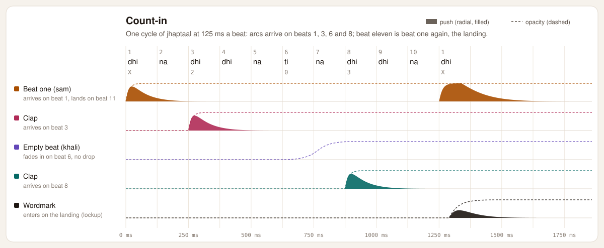

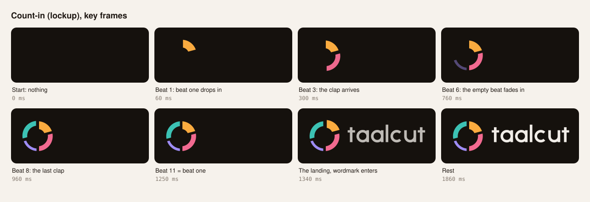

| Time | Beat | What happens |
| --- | --- | --- |
| 0 ms | 1 (X) | Beat one drops in |
| 250 ms | 3 (2) | The first clap drops in |
| 625 ms | 6 (0) | The empty beat fades in |
| 875 ms | 8 (3) | The second clap drops in |
| 1250 ms | 11 = 1 (X) | The landing: beat one pushes out 12 units |
| 1290 ms | | The wordmark enters (lockup only) |
| 1860 ms | | At rest |

### 5.2 Tihai: the celebration

Done, and it landed. The phrase is clap, wave, clap: the three arcs after beat one, so it runs clockwise around the ring. It plays three times at 60 %, 80 % and 100 % strength with a rest beat between, and the third phrase runs straight into the landing on beat one. Total 1.66 s. This is the export flow's one moment of delight (DESIGN.md: one per flow at most), so it is not used for routine saves.

**Where:** export finished. The app plays it once the file is written, next to the word "Exported".

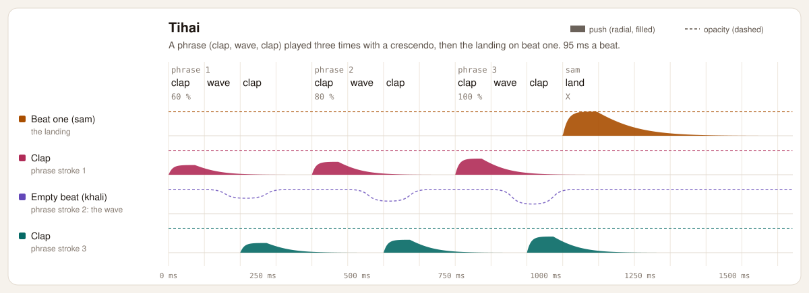

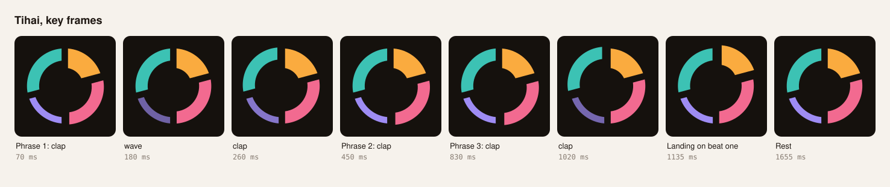

### 5.3 Keep time: work of unknown length

Claps on beats 1, 3 and 8, the wave on beat 6, looping every ten beats. While a reference reel is being analysed the tempo is 500 ms a beat. Once its beat map exists, the mark switches to the reel's own tempo, so the reel being made sets the pace.

**Where:** analysing a reference reel; rendering when no progress is reported.

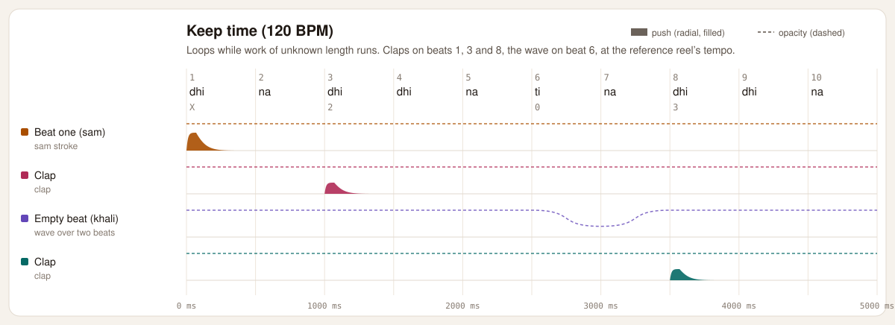

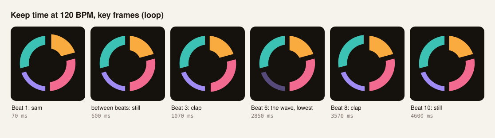

### 5.4 Thinking: the agent is working

Only the empty beat moves. It is the violet arc, and violet is the agent's colour, so the motion says "the AI is working" without a word. It dims to 45 % and returns on a 1.4 s loop. It replaces the usual three-dot typing indicator.

**Where:** the Agent panel, at 16–24 px, beside words such as "Planning the cut…".

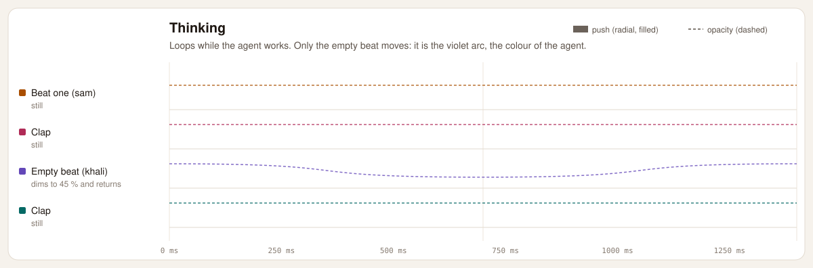

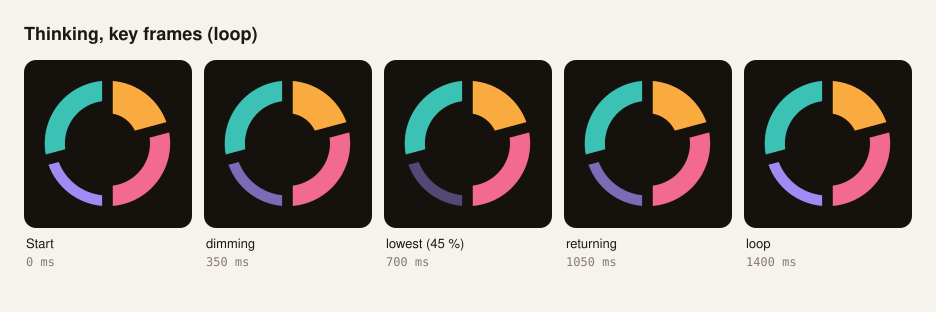

### 5.5 Progress: one cycle of work

The unlit arcs sit at 22 % and the lit part sweeps clockwise from the top. Each tenth of the work lights exactly one beat, and the arc ticks (3 units) as each beat completes. The tenth beat completes the cycle, so at 100 % beat one lands. The sweep eases toward each new value over 160 ms rather than jumping.

**Where:** export and render with known progress, always beside the percentage (for example "Rendering 42 %").

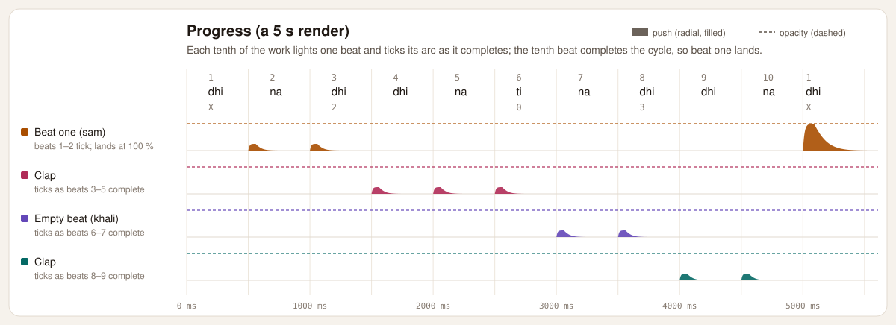

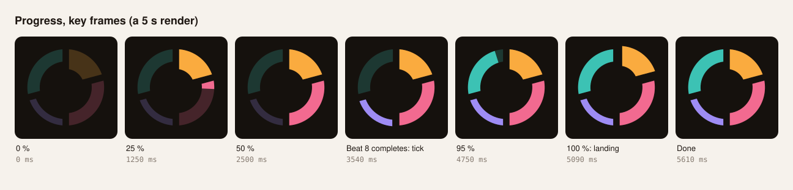

### 5.6 Tap: hover and press

One beat-one stroke: 8 units over 410 ms. It plays at most once every 600 ms, so moving the pointer across the logo doesn't stutter it.

**Where:** the website header logo, and the logo on the About screen.

## 6. Where motion lives

| Moment | Motion | Size | Version |
| --- | --- | --- | --- |
| App launch window | Count-in, once | 96–128 px | Symbol, four colours |
| First onboarding screen | Count-in, once | 120–160 px tall lockup | Lockup, four colours |
| Agent panel while working | Thinking | 16–24 px | Symbol (small drawing) |
| Analysing a reference | Keep time | 48–64 px | Symbol |
| Export or render | Progress, then tihai | 56–96 px | Symbol |
| Website hero | Count-in, once per session | 120 px+ tall lockup | Lockup |
| Website header | Tap on hover | 30 px tall | Lockup, two colours |
| About screen | Tap on press | 64 px | Symbol |
| Video sting (social, end cards) | Count-in | See §10 | Lockup, four colours on dark |

**Never animated:** the title bar, menus, settings, toasts and notifications, empty states, loading skeletons, docs pages, emails, and anything inside the video preview.

**Never** two moving marks on one screen, and never a loop on an idle screen.

## 7. Rules of play

- **One motion at a time.** A new motion replaces the current one with a 90 ms crossfade, starting from wherever the arcs are.
- **One-shots return to the state.** When a count-in, tihai or tap ends, the mark goes back to its state (idle, keep time, thinking or progress).
- **Off screen, nothing moves.** In a hidden window or scrolled out of view the mark stops drawing frames. Back in view, a progress sweep jumps to the current value without replaying its ticks.
- **Small sizes.** Below 40 px (the symbol) or 160 px wide (the lockup) the mark uses the kit's small drawing. There, hits become a dip to 55 % opacity, because a push of under a pixel only shimmers. Progress ticks are off.
- **Themes.** The colours come from the `--color-logo-1…4` and `--color-logo-ink` tokens. They resolve to the strong accents on light and the fills on dark, so a theme switch needs nothing from the mark. On dark the mark also uses the kit's thinned drawing.

## 8. Accessibility

| Motion | With reduced motion (OS setting, or the app's own setting) |
| --- | --- |
| Count-in | A 150 ms fade of the whole mark |
| Tihai | No movement; the word "Exported" carries it |
| Keep time | Still; the status text carries it |
| Thinking | Still, with the empty beat held at 55 % so the state stays visible |
| Progress | The sweep follows the value with no ticks and no landing |
| Tap | Nothing |

- **No flashing.** Hits move arcs; they don't change brightness, and opacity never drops to zero and back. The loops stay slow: keep time folds fast tempos so it never strikes more than 1.5 times a second, and thinking breathes once every 1.4 s. The quick strokes belong to the one-shots (count-in, tihai), which play once and end.
- **Motion never carries meaning alone.** Thinking, keep time and progress always sit beside words.
- **Semantics.** The mark is an image named "Taalcut". In the progress state it is a progress bar with its value (0–100), named by `label`. The app announces state changes through its own live region, not through the mark.
- **The app setting wins.** `motion="reduced"` applies the in-app "Reduce motion" setting whatever the OS says, and `motion="full"` lets someone opt back in.

## 9. Sound

No sound ships. Every beat still fires a `beat` event with its number, the theka syllable and the tala sign, and every landing fires `sam`. A future sonic logo should follow these events rather than its own clock. The theka is dhi na · dhi dhi na · ti na · dhi dhi na: the empty beat's "ti" is the stroke with no bass, which matches the visual wave.

## 10. Using it

### The component

[`taalcut-mark.js`](taalcut-mark.js) defines `<taalcut-mark>`, a dependency-free custom element. Types for TypeScript and React 19 JSX are in [`taalcut-mark.d.ts`](taalcut-mark.d.ts). Size it by height; the width follows.

| Attribute or property | Values | Default |
| --- | --- | --- |
| `variant` | `symbol`, `lockup` | `symbol` |
| `palette` | `four`, `two`, `mono` (mono uses `currentColor`) | `four` |
| `state` | `idle`, `keep-time`, `thinking`, `progress` | `idle` |
| `bpm` | The reference reel's tempo, for keep time | 0 (500 ms a beat) |
| `progress` | 0–1, for the progress state | 0 |
| `motion` | `auto` (follows the OS), `reduced`, `full` | `auto` |
| `label` | Accessible name | "Taalcut", or "Progress" |
| `autoplay` | Present: count-in on mount. `session`: once per browser session | absent |

| Method or event | Does |
| --- | --- |
| `play('count-in' \| 'tihai' \| 'tap')` | Plays a one-shot; returns a promise that resolves when it ends |
| `stop()` | Back to rest |
| `scrub(name, ms)` | Shows one frame without playing (benches, storyboards) |
| `beat` event | `detail`: `matra` (1–10), `bol`, `sign` (X, 2, 0, 3), `arc` (0–3), `landing` |
| `sam` event | The cycle resolved on beat one |
| `motionend` event | A one-shot finished; `detail.motion` names it |

```html
<script type="module" src="/design/logo/motion/taalcut-mark.js"></script>
<taalcut-mark variant="lockup" autoplay="session" style="height: 120px"></taalcut-mark>
```

```tsx
import '<path>/design/logo/motion/taalcut-mark.js';

function ExportStatus({ progress, done }: { progress: number; done: boolean }) {
  const mark = useRef<TaalcutMarkElement>(null);
  useEffect(() => { if (done) void mark.current?.play('tihai'); }, [done]);
  return (
    <div className="flex items-center gap-3">
      <taalcut-mark ref={mark} state={done ? 'idle' : 'progress'} progress={progress} label="Rendering" style={{ height: 64 }} />
      <span>{done ? t`Exported` : t`Rendering ${Math.round(progress * 100)} %`}</span>
    </div>
  );
}
```

React 19 passes props to custom elements as properties, and `on…` props as event listeners with the name as written. So the props are `onbeat`, `onsam` and `onmotionend`, all lowercase. The Electron app inherits the OS reduced-motion setting through Chromium, and passes its own setting through `motion`.

**Cost:** the mark draws frames only while something moves, touching only `transform` and `opacity` on four arc groups. When idle it costs nothing.

### Exports

| File | For |
| --- | --- |
| [`export/taalcut-count-in-lockup.svg`](export/taalcut-count-in-lockup.svg), [`-symbol.svg`](export/taalcut-count-in-symbol.svg), [`taalcut-tihai-symbol.svg`](export/taalcut-tihai-symbol.svg) | README, website and docs. Each plays once, needs no script, follows the viewer's light or dark setting, and holds still under reduced motion |
| `export/video/taalcut-count-in-16x9.mp4`, `-1x1.mp4`, `-9x16.mp4` | Social posts, reels and end cards: H.264, 60 fps, 3.8 s on the dark canvas |
| `export/video/taalcut-count-in-16x9-alpha.mov` | Video editors: QuickTime Animation with transparency, to place over footage |

### Rebuilding

```sh
python3 design/logo/build_kit.py            # the logo geometry, including motion/mark-geometry.js
node design/logo/motion/build-assets.mjs    # diagrams, storyboards, animated SVGs and stings
                                            # (--no-video skips the stings; they need cairosvg and ffmpeg)
python3 -m http.server                      # from the repo root, then open /design/logo/motion/bench.html
```

Change timing only in `choreography.js`, then rebuild. Every artefact here follows from it.

## 11. Don'ts

These are the habits that make logo motion look generated:

- Spinning the ring. It turns the mark into a loading spinner, and the cuts stop meaning anything.
- Elastic or bounce easing, or any overshoot past rest.
- Drawing the arcs on with a stroke sweep for the entrance. That is a progress donut, not a count.
- Gradient sweeps, glows, shimmer, particles, confetti or flares.
- Morphing the arcs into other shapes, or splitting them further.
- Typing out the wordmark letter by letter, or moving its letters separately.
- 3D tilts, parallax, or zooming in from nothing.
- Looping the count-in, or playing any motion on an idle screen.
- Retiming by eye in one place. Tempos and amounts live in `choreography.js`.

## 12. Checks run

| Check | Result |
| --- | --- |
| Easing maths against the browser | CSS `ease` at 50 % gives 0.8024 here, the same as the browser |
| Animated SVG against the component | Teal arc at 960 ms into the count-in: 4.470 units in the CSS export, 4.475 in the timeline (rounding) |
| Beat timing in Chrome | Count-in beats within one frame of schedule; keep time at 120 BPM fires every 500 ms |
| Progress | A 5 s export fires 10 completion beats, the landing, and one `sam` |
| Reduced motion | Count-in becomes a 158 ms fade; tihai doesn't move; keep time doesn't loop; thinking holds at 55 %; `motion="full"` overrides it |
| Small drawing | The bench's 16 and 24 px marks and the 106 px header lockup use the small drawing; 40 px and up use the standard one |
| Types | `tsc` passes with the repo's TypeScript 6.0.3 and with 5.9 (React 19.2 types) on the component, the choreography and a React usage sample; wrong props such as `state="spinning"` fail |
| Bench layout | No horizontal scroll and no two-line buttons at 320 px; light, dark and system themes |
| Stings | 60 fps, 226 frames each; the alpha MOV's background is fully transparent |
| Tokens | 156 of 156 contrast checks pass, including the 10 new logo checks |

## 13. Open items

| Item | When |
| --- | --- |
| Use the component in the app (launch window, Agent panel, export) once `packages/ui` exists, re-exported from there | With the UI kit |
| A sonic logo, if wanted, timed by the `beat` and `sam` events | Phase 3 |
| A Lottie export, only if a native surface needs one; the component and the animated SVG cover the app and the web | On demand |
